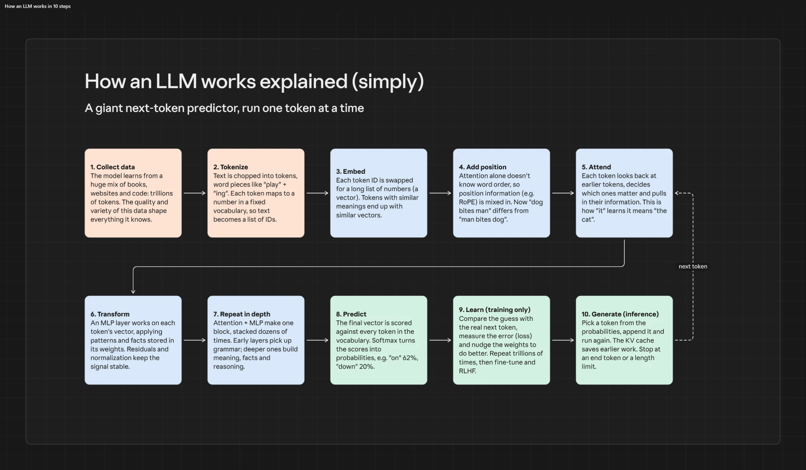

# LLM architecture basics

> An LLM is a giant next-token predictor: it turns text into vectors, refines them through a stack of attention + MLP blocks, and outputs a probability for every possible next token — one token at a time.

## Why it matters

Almost everything you deal with when building on LLMs traces back to this pipeline: cost and context limits are counted in tokens (step 2), "the model forgot the start of the prompt" is an attention question (step 5), temperature and top-p act on the output probabilities (steps 8 and 10), and latency is dominated by the generation loop running once per output token (step 10).

## How it works

The ten steps fall into three groups: preparing the input (1–2), the transformer itself (3–7), and producing output (8–10).

### Preparing the input

**1. Collect data.** The model learns from a huge mix of books, websites and code — trillions of tokens. The quality and variety of this data shape everything the model knows; it has no other source of knowledge apart from what you put in the prompt.

**2. Tokenize.** Text is chopped into tokens: word pieces such as `play` + `ing`. Each token maps to a number in a fixed vocabulary (typically tens of thousands to a few hundred thousand entries), so text becomes a list of integer IDs.

### Inside the transformer

**3. Embed.** Each token ID is swapped for a long list of numbers, a vector. These vectors are learned, and tokens with similar meanings end up with similar vectors.

**4. Add position.** Attention on its own has no notion of word order, so position information is mixed in (for example RoPE, rotary position embeddings). This is what makes "dog bites man" different from "man bites dog".

**5. Attend.** Each token looks back at the earlier tokens, decides which ones matter, and pulls in their information. This is how the vector for "it" comes to carry the meaning "the cat". In a decoder-only LLM a token can only look backwards, never at tokens that come after it (causal masking).

**6. Transform.** An MLP (feed-forward) layer then works on each token's vector separately, applying patterns and facts stored in its weights. Residual connections and normalization keep the signal stable as it passes through many layers.

**7. Repeat in depth.** Attention + MLP make one block, and blocks are stacked dozens of times. Roughly, early layers pick up surface features such as grammar, and deeper ones build meaning, facts and reasoning.

### Producing output

**8. Predict.** The final vector at the last position is scored against every token in the vocabulary, giving one raw score (logit) per token. Softmax turns the scores into probabilities, e.g. `on` 62%, `down` 20%.

**9. Learn (training only).** Compare the predicted probabilities with the real next token, measure the error (cross-entropy loss), and nudge the weights to do better using backpropagation and gradient descent. Repeat over trillions of tokens (pre-training), then fine-tune and apply RLHF to shape behaviour.

**10. Generate (inference).** Pick a token from the probabilities, append it to the input, and run again. The KV cache stores the attention keys and values of earlier tokens so they are not recomputed each time. Stop at an end-of-sequence token or a length limit.

## Example

Prompt: `The cat sat` — and the model is asked to continue.

| Step | What happens |
| --- | --- |
| Tokenize | `The`, ` cat`, ` sat` → three IDs, e.g. `[791, 8415, 7731]` (IDs are illustrative) |
| Embed + position | Three vectors, each tagged with where it sits in the sequence |
| Blocks | The vector at ` sat` attends to ` cat` and `The`, and is refined layer after layer |
| Predict | The final vector at ` sat` gives ` on` 62%, ` down` 20%, … |
| Generate | Sample ` on`, append it, and run again with `The cat sat on` |

## Gotchas

- **Steps 9 and 10 never happen together.** Training updates weights; inference only reads them. A deployed model does not learn from your prompts.
- **The loop arrow in the diagram is simplified.** It points from step 10 back to step 5, but a newly generated token is still embedded and given a position (steps 3–4) first. What the KV cache skips is redoing the work for the *earlier* tokens.
- **Tokens are not words.** A word can be one token or several, and the split differs between models, so token counts are not comparable across model families.
- **The model outputs a distribution, not a token.** Choosing from it (greedy, temperature, top-p) is a separate sampling step, which is why the same prompt can give different answers.
- **Position schemes vary.** RoPE is common in recent models, but others use learned or sinusoidal position embeddings; the purpose is the same.
- **"Early layers = grammar, deep layers = reasoning" is a rough tendency**, not a clean division.

## Revise

1. Why does attention need position information added separately?
2. What is the difference between an embedding vector and a logit?
3. In one block, what does attention do that the MLP cannot, and the other way round?
4. Which steps happen only in training, and which only in inference?
5. What does the KV cache store, and why does it make generation faster?
6. Why does generating 500 tokens take much longer than reading a 500-token prompt?

## See also

- [Tokens, tokenization and the context window](tokens-and-context-window.md) — step 2 in depth, plus the cost and context math
- Diagram: [architecture-basics.webp](../../diagrams/fundamentals/architecture-basics.webp)
